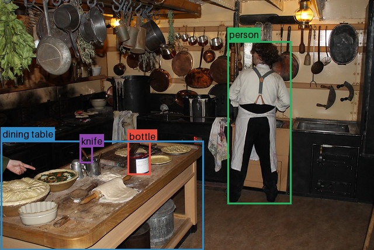

# Usage

## Draw a single bounding box

Coordinates are `xyxy` by default: `(x_min, y_min, x_max, y_max)`.

```python
from PIL import Image

from bbox_viz import draw_bbox

image = Image.new("RGB", (400, 400), "white")
annotated = draw_bbox(
    image,
    (40, 50, 220, 260),
    color=(255, 0, 0),
    label="person",
)
annotated.save("single-box.png")
```

The input image is never modified in place. The returned image can therefore be used for another annotation:

```python
annotated = draw_bbox(
    annotated,
    (250, 100, 360, 300),
    color=(0, 128, 0),
    label="bicycle",
    label_top=False,
)
```

## Coordinate formats

Use `bbox_format` to select one of the supported formats:

- `xyxy`: `(x_min, y_min, x_max, y_max)`
- `xywh`: `(x_min, y_min, width, height)`
- `cxcywh`: `(x_center, y_center, width, height)`

```python
draw_bbox(
    image,
    (0.5, 0.5, 0.4, 0.3),
    bbox_format="cxcywh",
    bbox_is_normalized=True,
    color=(0, 0, 255),
)
```

Normalized coordinates are converted using the image width and height.
Bounding-box coordinates are rounded to integer pixel positions before drawing.

## Draw multiple boxes

`draw_multiple_bboxes` applies one set of options to each box. If `colors` is omitted, colors are selected from the built-in palette.
A single RGB tuple can be shared by every box, or a list of colors can be supplied.

```python
from bbox_viz import draw_multiple_bboxes

bboxes = [
    (20, 30, 150, 220),
    (180, 60, 330, 280),
]

annotated = draw_multiple_bboxes(
    image,
    bboxes,
    labels=["person", "car"],
    colors=[(255, 0, 0), (0, 128, 255)],
    thickness=3,
)
```

When `labels`, `colors`, or `label_colors` are provided as lists, each list must have the same length as `bboxes`.

## Public dataset example

The following example uses image `397133` from the [COCO 2017 validation
set](https://cocodataset.org/#download) and its ground-truth annotations.
COCO stores bounding boxes as `(x, y, width, height)`, so select
`bbox_format="xywh"`:

```python
from pathlib import Path

from PIL import Image

from bbox_viz import draw_multiple_bboxes

image = Image.open(Path("docs/assets/coco-397133.jpg"))

# Ground-truth COCO annotations for image 397133.
bboxes = [
    (217.62, 240.54, 38.99, 57.75),    # bottle
    (1.00, 240.24, 346.63, 186.76),    # dining table
    (388.66, 69.92, 109.41, 277.62),   # person
    (135.57, 249.43, 22.32, 28.79),    # knife
]

annotated = draw_multiple_bboxes(
    image,
    bboxes,
    bbox_format="xywh",
    labels=["bottle", "dining table", "person", "knife"],
    thickness=3,
)
annotated.save("coco-397133-annotated.jpg")
```


*Original image from COCO image `397133`.*



*The same image rendered with `bbox-viz` and the COCO ground-truth boxes.*


## Draw labels independently

Use `draw_label` when a label is needed without drawing a box:

```python
from bbox_viz import draw_label

annotated = draw_label(
    image,
    (40, 50, 220, 260),
    "person",
    fill_color=(255, 0, 0),
    label_color=(255, 255, 255),
)
```

For multiple labels, use `draw_multiple_labels`:

```python
from bbox_viz import draw_multiple_labels

annotated = draw_multiple_labels(
    image,
    bboxes,
    ["person", "car"],
    fill_colors=[(255, 0, 0), (0, 128, 255)],
)
```

## Complete example

The repository includes an executable notebook with the examples used during development: [`examples/examples.ipynb`](https://github.com/zhiqin1998/bbox-viz/blob/main/examples/examples.ipynb).
